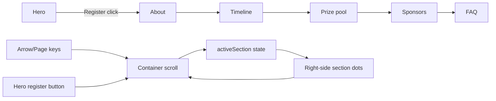
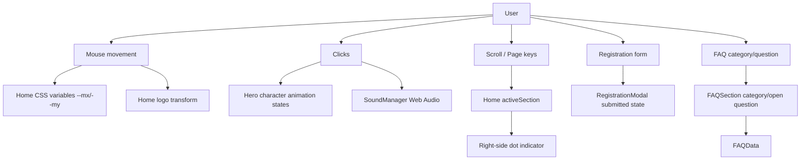

# Genesis project onboarding and codebase map

> Generated from the current source tree and import/usage trace on 2026-10-20.
> The repository does not currently contain `.understand-anything/knowledge-graph.json`;
> the diagrams below are a source-based knowledge graph maintained in this guide.

## 1. Project overview

Genesis is a single-page, visually rich event website built with the Next.js App Router.
The live experience presents a cosmic/game-themed landing page for a Genesis event,
with a full-screen hero, event information sections, timeline, prize pool, sponsors,
and FAQs.

| Area | Current implementation |
|---|---|
| Application framework | Next.js `16.4.0`, App Router |
| UI runtime | React `19.3.0` |
| Language | TypeScript with strict checking |
| Styling | Tailwind CSS `4` through the Turbopack loader, plus `app/globals.css` |
| Animation/audio | CSS keyframes, DOM/CSS-variable animation, Web Audio API |
| Data/backend | No database or external API is currently wired into the live page |
| Static content | Images/SVGs/PDFs under `public/` and `required files/` |
| Main route | `/` from `app/page.tsx` |
| Brochure route | `/brochure` from `app/brochure/route.ts` |

### Runtime mental model

This is primarily a presentation application, not a data-backed product yet:

1. Next renders the root layout and the home page.
2. `Home` owns the page scroll container, active-section state, hero interactions,
   and the full-screen section order.
3. Section components own their local animation, responsive scaling, and interaction state.
4. Static assets provide most of the visual design.
5. Client-only audio is synthesized in the browser by `SoundManager`.
6. The brochure route reads a PDF from disk and returns it as an inline response.

## 2. Directory structure

Generated directories and dependencies (`.next/`, `node_modules/`, `.git/`) are omitted
from the functional tree below.

```text
genesis/
├── app/                                  # Next.js App Router application
│   ├── brochure/
│   │   └── route.ts                      # GET /brochure; serves brochure PDF
│   ├── components/                       # Active and reusable React UI components
│   │   ├── AboutSection.tsx
│   │   ├── BrochureModal.tsx             # Reusable, not imported by current Home
│   │   ├── ClientCleanup.tsx             # Hydration-time SW/cache cleanup
│   │   ├── FAQAccordionItem.tsx
│   │   ├── FAQSection.tsx
│   │   ├── MenuDrawer.tsx                # Reusable, not imported by current Home
│   │   ├── MilestoneBadge.tsx
│   │   ├── Navbar.tsx                    # Reusable, not imported by current Home
│   │   ├── PrizePoolSection.tsx
│   │   ├── RegistrationModal.tsx          # Reusable, not imported by current Home
│   │   ├── sound.ts                       # Browser Web Audio sound manager
│   │   ├── SponsorsSection.tsx
│   │   └── TimelineSection.tsx
│   ├── data/
│   │   └── faqData.ts                    # Typed FAQ categories and question content
│   ├── globals.css                        # Global styles, utilities, keyframes, responsive CSS
│   ├── layout.tsx                         # Root HTML shell, fonts, metadata, cleanup hook
│   ├── page.tsx                           # Live home page composition and hero controller
│   └── favicon.ico
├── components/                            # Legacy/source asset staging PNGs; not TS components
├── public/                                # Browser-served static assets
│   ├── about/                             # Older/about artwork and navigation SVGs
│   ├── about-v2/                          # Alternate about artwork
│   ├── assets/                            # Hero artwork, logos, characters, planets, props
│   ├── faq/                               # FAQ background, banners, category/question SVGs
│   ├── prizepool/                          # Prize-pool navigation/stat artwork
│   ├── prize-pool/                         # Prize backgrounds and brawler assets
│   ├── sponsors/                           # Sponsor artwork and SVG navigation
│   └── timeline/                           # Timeline stage artwork
├── required files/                         # Source/reference files, including brochure PDF
│   ├── GENESIS_6_BROCHURE_.pdf
│   ├── ABout/
│   ├── FAQ/
│   ├── prize pool/
│   ├── sponser/
│   └── timeline/
├── next.config.ts                          # Next/Turbopack, dev origins, no-cache headers
├── package.json                            # Scripts and dependencies
├── tsconfig.json                           # Strict TypeScript and @/* alias
├── eslint.config.mjs                       # ESLint configuration
├── next-env.d.ts                           # Next-generated TypeScript references
└── public/GENESIS_6_BROCHURE_.pdf          # Public brochure copy
```

### Important asset convention

An asset in `public/foo/bar.svg` is referenced at runtime as `/foo/bar.svg`, not
`/public/foo/bar.svg`. Most UI components follow this convention through
`next/image` or regular `` tags.

## 3. Architecture knowledge graph

```mermaid
flowchart TD
  Browser[Browser] --> Root[app/layout.tsx]
  Root --> Cleanup[ClientCleanup]
  Root --> Home[app/page.tsx]
  Root --> CSS[app/globals.css]
  Root --> Fonts[Next Google fonts]

  Home --> Hero[Hero scene + page controller]
  Home --> About[AboutSection]
  Home --> Timeline[TimelineSection]
  Home --> Prize[PrizePoolSection]
  Home --> Sponsors[SponsorsSection]
  Home --> FAQ[FAQSection]
  Home --> Sound[sound.ts]

  FAQ --> FAQData[faqData.ts]
  FAQ --> FAQItem[FAQAccordionItem]
  FAQItem --> Sound
  Timeline --> Milestone[MilestoneBadge]
  Timeline --> Sound
  Prize --> Sound
  Sponsors --> Sound

  Hero --> Assets[public/assets]
  About --> AboutAssets[public/about + public/about-v2]
  Timeline --> TimelineAssets[public/timeline]
  Prize --> PrizeAssets[public/prize-pool + public/prizepool]
  Sponsors --> SponsorAssets[public/sponsors]
  FAQ --> FAQAssets[public/faq]

  Browser --> Brochure[/brochure]
  Brochure --> Route[app/brochure/route.ts]
  Route --> PDF[required files/GENESIS_6_BROCHURE_.pdf]
  Route -. optional mirror .-> PublicPDF[public/GENESIS_6_BROCHURE_.pdf]
```

## 4. Live page flow



The live page uses one internal `overflow-y-auto` container rather than relying solely
on document scrolling. `Home` detects section positions by IDs and updates the right-side
section indicator. The canonical section IDs are:

| Section | ID | Owner |
|---|---|---|
| Hero | `hero` | `app/page.tsx` |
| About | `about` | `AboutSection.tsx` |
| Timeline | `timeline` | `TimelineSection.tsx` |
| Prize pool | `prizepool` | `PrizePoolSection.tsx` |
| Sponsors | `sponsors` | `SponsorsSection.tsx` |
| FAQ | `faq` | `FAQSection.tsx` |

## 5. Responsibility map: which file handles what

### Application shell and routing

| File | Responsibility | Change this when... |
|---|---|---|
| [`app/layout.tsx`](../app/layout.tsx) | Defines the root HTML/body shell, page metadata, font variables, and `ClientCleanup`. | Changing SEO metadata, global fonts, root classes, or layout-wide providers. |
| [`app/page.tsx`](../app/page.tsx) | Composes the six live sections; owns hero visuals, scroll tracking, keyboard navigation, section dots, mute state, and hero character interactions. | Changing page order, hero behavior, page-level navigation, or cross-section state. |
| [`app/brochure/route.ts`](../app/brochure/route.ts) | Implements `GET /brochure`; reads the brochure PDF, returns PDF headers, and attempts a public copy. | Changing brochure delivery, file location, caching, or error responses. |
| [`next.config.ts`](../next.config.ts) | Configures allowed dev origins, no-cache headers, and Tailwind/Turbopack CSS loading. | Changing development access, caching policy, or build CSS handling. |
| [`package.json`](../package.json) | Defines `dev`, `build`, `start`, and `lint`; declares Next, React, GSAP, Tailwind, and tooling dependencies. | Changing scripts or dependencies. |

### Live sections

| File | Responsibility | Important state/behavior |
|---|---|---|
| [`app/components/AboutSection.tsx`](../app/components/AboutSection.tsx) | About/intro section and its static artwork/content. | Mostly presentational. |
| [`app/components/TimelineSection.tsx`](../app/components/TimelineSection.tsx) | Four-stage event roadmap: registration, online round, offline showdown, result. | Responsive mobile/desktop layout, drag/hover/pointer interactions, IntersectionObserver entry state, stage selection. |
| [`app/components/MilestoneBadge.tsx`](../app/components/MilestoneBadge.tsx) | Visual badge used by the timeline stages. | Presentation helper for `TimelineSection`. |
| [`app/components/PrizePoolSection.tsx`](../app/components/PrizePoolSection.tsx) | Prize showcase with responsive canvas scaling and hover audio. | Desktop/mobile variants, resize listener, hover sound cooldown. |
| [`app/components/SponsorsSection.tsx`](../app/components/SponsorsSection.tsx) | Sponsor showcase and sponsor artwork. | Presentational section with hover/click sound behavior. |
| [`app/components/FAQSection.tsx`](../app/components/FAQSection.tsx) | FAQ screen with category tabs, responsive scaling, transitions, and one-open-question behavior. | Owns selected category/question and resize/transition timers. |
| [`app/components/FAQAccordionItem.tsx`](../app/components/FAQAccordionItem.tsx) | Renders an individual FAQ row and expanded answer. | Uses typed `FAQItem`, question artwork, and sound feedback. |
| [`app/data/faqData.ts`](../app/data/faqData.ts) | Typed FAQ domain data: categories, questions, answers, source notes, verification flags, and asset paths. | Update content here rather than hardcoding new FAQ rows in the component. |

### Interaction and utility components

| File | Responsibility | Current wiring |
|---|---|---|
| [`app/components/sound.ts`](../app/components/sound.ts) | Singleton-style `SoundManager` using Web Audio API oscillators for hover, click, register, pop, laser, shuriken, coin, and gem sounds. | Imported by the live page and live sections. |
| [`app/components/ClientCleanup.tsx`](../app/components/ClientCleanup.tsx) | Client-only unregister of service workers and deletion of CacheStorage after hydration. | Mounted by `RootLayout`; affects the entire site in the browser. |
| [`app/components/Navbar.tsx`](../app/components/Navbar.tsx) | Alternate responsive navbar with desktop links and mobile dropdown. | Not imported by `Home` currently; treat as reusable/unfinished integration. |
| [`app/components/MenuDrawer.tsx`](../app/components/MenuDrawer.tsx) | Alternate menu drawer. | Not imported by `Home` currently. |
| [`app/components/RegistrationModal.tsx`](../app/components/RegistrationModal.tsx) | Client-side registration form and success state. | Not imported by `Home`; submission is local UI state only and does not call an API. |
| [`app/components/BrochureModal.tsx`](../app/components/BrochureModal.tsx) | Tabbed in-page brochure content modal. | Not imported by `Home`; the live hero uses `/brochure` instead. |

## 6. Key concepts and design decisions

1. **Client-first visual experience.** `page.tsx` and most interactive sections are
   client components because they use state, browser events, DOM refs, audio, and
   responsive measurements.
2. **Direct DOM updates for high-frequency motion.** Mouse parallax and logo tilt update
   CSS variables/styles through refs and `requestAnimationFrame` instead of causing a
   React render for every pointer event.
3. **Full-screen section composition.** Each major section is approximately one viewport
   high and is placed in a fixed sequence inside the page scroll container.
4. **Artwork-driven UI.** Important labels and navigation artwork are often SVG/bitmap
   assets rather than text, so visual changes commonly require editing both component
   placement and files under `public/`.
5. **Typed content boundary.** FAQ content is separated into `FAQ_DATA`; the UI owns
   selection and expansion state while the data file owns questions and source metadata.
6. **No persistence yet.** The registration modal shows a success screen but does not
   send or store registration data. The brochure route reads from the local filesystem.
7. **Responsive scaling by measurement.** Timeline, prize pool, and FAQ calculate a
   scale from viewport dimensions to preserve a designed desktop composition.

## 7. Interaction knowledge graph



## 8. Guided tour for a new developer

### Tour 1: Start at the shell

Read [`app/layout.tsx`](../app/layout.tsx) first. Note the metadata, font variables,
global body classes, and the fact that `ClientCleanup` runs on every page load.

### Tour 2: Follow the home page composition

Read the imports and the JSX near the bottom of [`app/page.tsx`](../app/page.tsx).
The six rendered sections are the authoritative live product surface. Then read the
top half of the file for page-level state and event handling.

### Tour 3: Understand navigation and active-section tracking

Trace `containerRef`, `activeSection`, `lastSectionRef`, the scroll listener, keyboard
listener, and right-side dot buttons in [`app/page.tsx`](../app/page.tsx). This is the
cross-section coordinator.

### Tour 4: Learn one complex interactive section

Start with [`app/components/TimelineSection.tsx`](../app/components/TimelineSection.tsx).
It demonstrates the project’s main patterns: refs for pointer/drag performance,
responsive detection, `IntersectionObserver`, stage state, and sound feedback.

### Tour 5: Learn content-driven UI

Read [`app/data/faqData.ts`](../app/data/faqData.ts), then
[`app/components/FAQSection.tsx`](../app/components/FAQSection.tsx) and
[`app/components/FAQAccordionItem.tsx`](../app/components/FAQAccordionItem.tsx).
This is the clearest example of a typed data-to-component boundary.

### Tour 6: Follow the asset pipeline

Open the corresponding folders under [`public/`](../public/). Match component paths
such as `/faq/...`, `/timeline/...`, `/prize-pool/...`, and `/assets/...` to files on disk.
Remember that `public` itself is not part of the URL.

### Tour 7: Follow the brochure path

Open [`app/brochure/route.ts`](../app/brochure/route.ts) and compare it with
`required files/GENESIS_6_BROCHURE_.pdf`. Test `/brochure` separately from the home page.

## 9. Complexity hotspots

| Hotspot | Why it is harder to change safely |
|---|---|
| [`app/page.tsx`](../app/page.tsx) | Large hero scene plus global scroll/keyboard coordination and many asset placements. Small layout changes can affect z-index, viewport behavior, or navigation state. |
| [`app/globals.css`](../app/globals.css) | Large global stylesheet with animation keyframes and responsive rules shared by the artwork-heavy page. |
| [`app/components/TimelineSection.tsx`](../app/components/TimelineSection.tsx) | Combines drag tracking, refs, pointer events, IntersectionObserver, responsive layouts, and stage transitions. |
| [`app/components/PrizePoolSection.tsx`](../app/components/PrizePoolSection.tsx) | Uses viewport-derived scaling and separate responsive presentations. |
| [`app/components/FAQSection.tsx`](../app/components/FAQSection.tsx) | Has category transition timers, accordion state, resize scaling, and a large asset-driven layout. |
| [`app/components/sound.ts`](../app/components/sound.ts) | Browser autoplay/audio-policy behavior and repeated oscillator setup make cross-browser testing important. |
| [`app/brochure/route.ts`](../app/brochure/route.ts) | Performs filesystem reads and a write/copy attempt during a GET request; deployment filesystem semantics may differ from local development. |

## 10. Known integration and consistency notes

These are observations for maintainers, not changes made by this report:

- The live `Home` component does not import `Navbar`, `MenuDrawer`, `RegistrationModal`,
  or `BrochureModal`. They may be older designs or intended future integrations.
- [`Navbar.tsx`](../app/components/Navbar.tsx) points its prize link at `#prize`, while
  the live section ID is `#prizepool`. If that navbar is mounted, the prize link will
  not land on the live section without reconciliation.
- The hero/page copy describes a Brawl Stars tournament, while parts of
  [`faqData.ts`](../app/data/faqData.ts) describe Genesis as a 24-hour game jam.
  Product owners should establish one authoritative event narrative before expanding
  content.
- Registration currently displays a success state locally; there is no network request,
  server action, validation service, or persistence layer behind it.
- `ClientCleanup` clears all CacheStorage entries and unregisters all service workers
  in the browser. This is intentionally aggressive and should be reviewed before
  introducing offline caching or a service worker.
- The brochure route attempts to copy a file into `public/` during a GET. This is
  convenient locally but may be unsuitable for read-only or serverless deployments.

## 11. Useful commands

```powershell
npm run dev       # Start local development server
npm run lint      # Run ESLint
npm run build     # Validate a production build
npm run start     # Serve the production build
```

## 12. Suggested next steps for the team

1. Decide whether the live event is the Brawl Stars tournament or the game jam, then
   align hero copy, FAQ data, brochure, timeline, and prize content.
2. Decide which navigation/modal implementation is canonical and remove or integrate
   the unused alternatives.
3. If registration is intended to be real, define a backend/API contract and replace
   the local-only success state with explicit submission, loading, validation, and
   error states.
4. Test the brochure route on the target deployment platform before relying on
   filesystem writes.
5. Run `/understand` in the project to generate `.understand-anything/knowledge-graph.json`;
   that graph can then provide symbol-level call/import relationships beyond this
   source-based guide.
